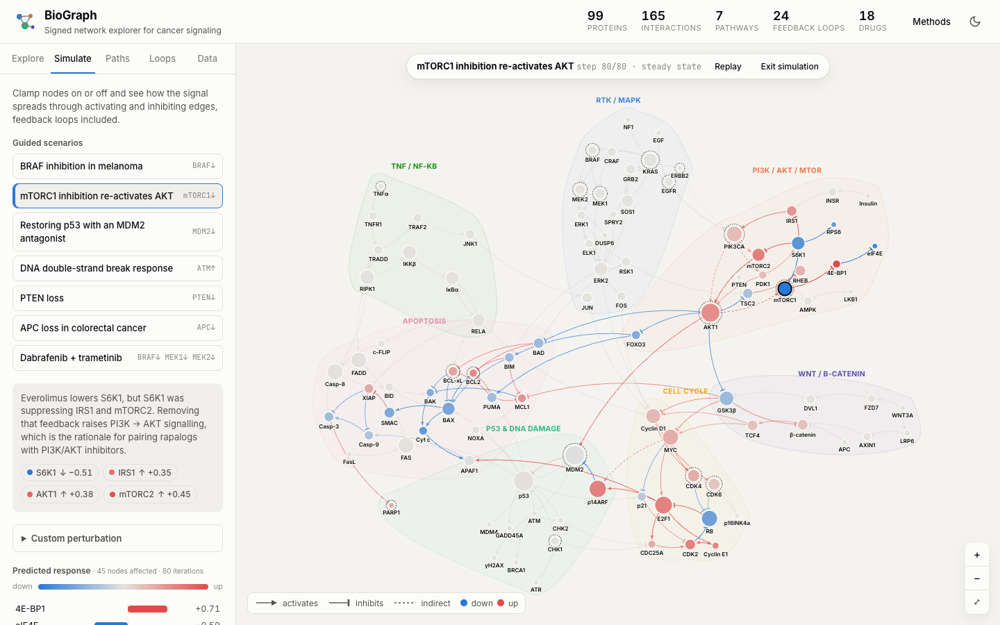

# BioGraph

**An interactive explorer for signed, directed signaling networks in human cancer.**

BioGraph shows 99 proteins and 165 curated regulatory interactions across seven canonical cancer pathways. You can explore the network and also compute on it in the browser: rank bottleneck proteins, simulate drugs and knockouts propagating through feedback loops, trace signed paths between any two proteins, and list every feedback loop.



## Features

| | |
|---|---|
| **Explore** | Force-directed layout clustered by pathway (RTK/MAPK, PI3K/AKT/mTOR, p53, cell cycle, apoptosis, NF-κB, Wnt). Nodes can be colored by pathway, cancer role (oncogene / tumor suppressor) or druggability, and sized by betweenness, PageRank or degree. Click a node for its regulators, targets, centrality ranks and the drugs that target it. |
| **Simulate** | Signed network propagation of a perturbation, animated step by step. Includes seven guided scenarios (e.g. *mTORC1 inhibition re-activates AKT* through the S6K1–IRS1 feedback loop). You can also inhibit or activate any protein, or apply one of 18 drugs. |
| **Paths** | Finds every shortest path between two proteins with its **net sign** (two inhibitions in a row make an activation). Paths that disagree in sign are flagged as context-dependent. |
| **Loops** | Lists all 24 elementary feedback loops up to 8 steps and labels each one positive (switch-like) or negative (homeostatic). |
| **Data** | Searchable table of interactions, with export to JSON (including computed metrics) or CSV. |

## Methods

- **Network.** A hand-curated, signed (activation / inhibition), directed graph built from KEGG maps hsa04010, hsa04151, hsa04115, hsa04110, hsa04210, hsa04064 and hsa04310 and the review literature. Multi-step mechanisms are marked *indirect*. CDKN2A is split into p16<sup>INK4a</sup> and p14<sup>ARF</sup>, and mTOR into mTORC1 and mTORC2, because the two products in each pair have different regulators and drug sensitivities.
- **Centrality.** Brandes' betweenness on the directed graph (normalised), and PageRank (d = 0.85).
- **Perturbation propagation.** Perturbed nodes are clamped to ±1. Every other node iterates
  `x_v ← (1−λ)·x_v + λ·δ·tanh(γ · Σ_{u→v} s_uv·x_u / √k_v^in)`
  with gain γ = 1.2, per-hop attenuation δ = 0.85 and damping λ = 0.5. The update is bounded and damped, so it converges to a steady state even with feedback loops in the network. Outputs are qualitative changes relative to baseline.
- **Signed paths.** BFS over a shortest-path DAG; each path's net sign is the product of its edge signs.
- **Feedback loops.** Depth-first enumeration of elementary cycles, each rooted at its lowest-index node so it is counted once.

**Validation.** Unit tests check data integrity, the graph algorithms on toy graphs, and that every guided scenario gives the direction of change reported in the literature. Examples: BRAF inhibition relieves ERK→SOS1 feedback; rapalogs raise AKT; MDM2 antagonism induces p21/PUMA/BAX; APC loss raises MYC and cyclin D1.

**Limitations.** The model leaves out many proteins and isoforms, cell-type context, dosage and timing. Its predictions are hypotheses, not quantitative forecasts.

## Running it

Open `index.html` in a browser. There is no build step, and the only dependency is D3 v7, loaded from a CDN. To serve it locally:

```bash
npm start          # python3 -m http.server 8000 → http://localhost:8000
npm test           # node --test (requires Node 18+)
```

To host it on **GitHub Pages**, go to Settings → Pages → Deploy from branch → `main` / root.

## Project layout

```
index.html          UI shell and Methods dialog
css/style.css       Light/dark theme tokens and layout
js/data.js          Curated nodes, signed edges, drugs, scenarios
js/analysis.js      Graph algorithms (no DOM; shared by browser and tests)
js/app.js           D3 rendering and interaction
tests/              node:test suite
```
